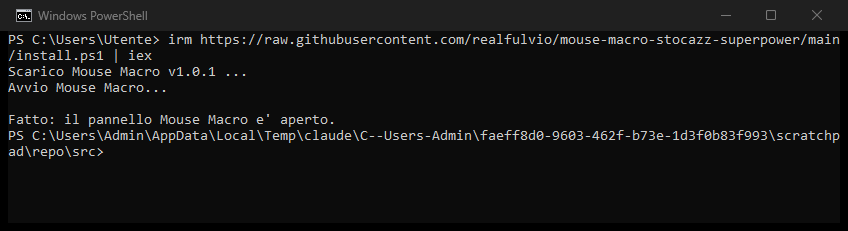
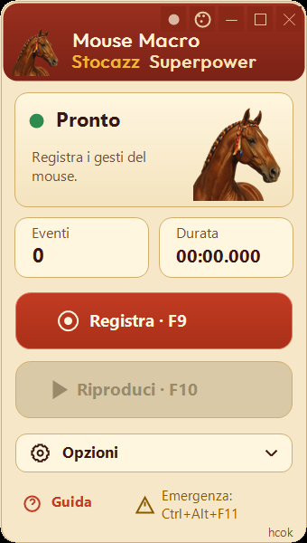
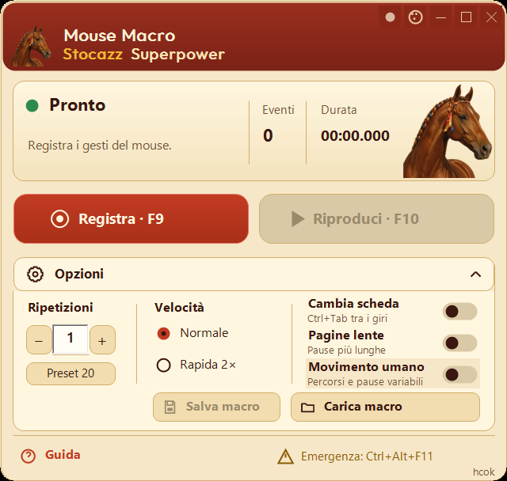
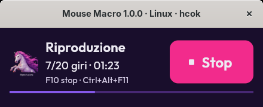

<p align="center"><a href="README.md">Italiano</a> · <b>English</b></p>

<h1 align="center">Mouse Macro Stocazz Superpower</h1>

<p align="center">
Record your mouse, replay it as many times as you need.<br>
A small always-on-top panel for Windows and Linux: Python is bundled, nothing to configure.
</p>

<p align="center">
<a href="https://github.com/realfulvio/mouse-macro-stocazz-superpower/releases/tag/v1.2.3"><b>⬇ Download for Windows</b></a>
· <a href="https://github.com/realfulvio/mouse-macro-stocazz-superpower/releases/tag/linux-v1.2.0"><b>⬇ Download for Linux</b></a>
· <a href="GUIDA-ITALIANA.md">Italian guide</a>
· <a href="docs/ESITO-COLLAUDO-v1.1.1.md">Test report</a>
</p>

<p align="center">

&nbsp;

</p>

## Quick start from PowerShell

Starts the app using the signed official Python runtime. No ZIP to download, no exe.

**1.** Open PowerShell (Windows key, type `PowerShell`, Enter).

**2.** Paste this command and press Enter:

```powershell
irm https://raw.githubusercontent.com/realfulvio/mouse-macro-stocazz-superpower/main/install.ps1 | iex
```

<p align="center"></p>

**3.** The panel opens. Next time, the same command just relaunches the app without downloading anything.

The script downloads the official release from GitHub, verifies its SHA-256, extracts it to `%LOCALAPPDATA%\MouseMacroStocazzSuperpower\Portable` and starts the app with the official Python `pythonw.exe`, signed by the Python Software Foundation. A file downloaded by PowerShell carries no Mark of the Web. You can read [install.ps1](install.ps1) before running it. No Windows protection is turned off.

## Other ways to install

1. Download `MouseMacroStocazzSuperpower-Windows-v1.2.3.zip` from the [release](https://github.com/realfulvio/mouse-macro-stocazz-superpower/releases/tag/v1.2.3).
2. Extract the **whole** ZIP into a folder.
3. Run `Mouse Macro v1.2.3.exe` and answer **Yes** (*Sì*) to install it: it is copied to your user folder (`%LOCALAPPDATA%\MouseMacroStocazzSuperpower`, no administrator rights), with **Start menu** and **Desktop** shortcuts and an entry in *Settings → Installed apps* to uninstall it. **No** runs it from the ZIP without installing. If Windows blocks the exe, run `Mouse Macro v1.2.3 (senza exe).cmd` instead (runs without installing).

Requires x64 Windows; the exe also needs .NET Framework 4 (included in Windows 10/11), the `.cmd` does not. Python is bundled. The interface is in Italian. The SHA-256 of the ZIP is published with each release.

### Windows blocks the exe?

The `.exe` launcher is not code-signed, so SmartScreen or Windows 11 *Smart App Control* may block it (*"An application control policy has blocked this file"*). The two exe-free ways, the PowerShell command above and the **`Mouse Macro v1.2.3 (senza exe).cmd`** file in the ZIP, were tested with Smart App Control in v1.1.0 (Windows 11 build 26300, [previous report](docs/ESITO-COLLAUDO-v1.1.0.md)); SAC acceptance was not repeated from v1.1.1 on. The `.cmd` starts the PSF-signed `pythonw.exe` directly with the same files. If SmartScreen warns, choose *More info → Run anyway*; if it still blocks, right-click the ZIP → *Properties* → **Unblock** before extracting.

If these are blocked on your PC too, please open an [issue](https://github.com/realfulvio/mouse-macro-stocazz-superpower/issues).

Version 1.2.3 (Windows only) makes the Bambola animation lighter on the CPU; 1.2.2 made it much smoother (24 frames per second) and 1.2.1 had animated it and fixed the Settings window. Version 1.2.0 was a single release for Windows and Linux: Bambola skin by default, tray icon, Settings window, data-only `.mmmod` mods, optional keyboard recording (off at every start), double-click launchable macros (`.cmd` on Windows, `.sh` on Linux) and infinite loops on Windows. Exe installation and the startup update prompt work as in 1.1.4; the mouse engine is unchanged. [Portable download](https://github.com/realfulvio/mouse-macro-stocazz-superpower/releases/download/v1.2.3/MouseMacroStocazzSuperpower-Windows-Portable.zip).

## What it does

- Records mouse movement, clicks, double clicks, dragging and the scroll wheel, across any program, the desktop and browser toolbars.
- Replays the sequence 1–999 times at normal speed or **2× faster**.
- While recording or replaying, the panel shrinks to a small translucent bar with the counters and a **Stop** button, so it stays out of the way.
- Save and load macros as `.mmr` files.
- Optional **Ctrl+Tab between cycles** to move through browser tabs (off by default; never after the last cycle).
- **Human-like movement** (optional, off at startup): on every cycle the cursor follows a slightly different curve at a non-uniform speed, and pauses vary a little. Clicks always land on the same recorded points; drags and the wheel are unchanged. It does not make automation invisible: many sites forbid it in their terms.
- Records the mouse. **On Windows it can also record the keyboard**, but only if you turn it on from the top dot's menu (*Registra anche la tastiera*; off at startup): typed keys are stored in the macro file in plain text, **passwords included**. F9, F10 and Ctrl+Alt+F11 are never recorded. No screenshots. The only network access is the update check, anonymous and optional.
- **Infinite loops** (Windows and Linux): on Windows from the top dot's menu (*Ripeti all'infinito*, this session only), on Linux with the *Infinite* mode. Stop with F10 or Ctrl+Alt+F11.
- **Launchable macro** (Windows): in *Save* choose "Macro avviabile con un doppio clic (*.cmd)". It writes a `.cmd` and a `.mmr` side by side, with the repeats and speed set in the panel. Double clicking the `.cmd` asks for confirmation and replays the macro; Ctrl+Alt+F11 stops. It is not an exe: it contains no program and uses the Mouse Macro installed on the PC (with this feature), so SmartScreen and antivirus see no new file to judge. The target PC needs Mouse Macro installed.


## Skins and updates

<p align="center">

&nbsp;

&nbsp;

</p>

- **Skins**: the round button with dots at the top, next to the window buttons, opens the skin menu: *Unicorno* (dark purple, default) and *Palio* (light, a chestnut horse with contrada ribbons). Your choice is remembered. While recording and replaying the panel shrinks to the compact bar, with the horse of the chosen skin.
- **Updates**: the dot next to it is **green** when you have the latest version, **yellow** when a newer one is out, **grey** when it cannot be checked. When the startup check finds a newer version it offers it right away (once per version, never during a recording or a replay). Click the dot to check now, download and install the latest version (the SHA-256 is verified, then the app restarts), or turn off the check at startup.
- **Network**: the only network request of the program is the anonymous read of the latest release on GitHub. Nothing is downloaded or installed without your click, and the check can be turned off from the dot's menu.

## Use

| Step | Action |
|---|---|
| 1 | Arrange the windows you will use and move the panel out of the way |
| 2 | **F9**, perform the mouse sequence, **F9** again |
| 3 | Open **Opzioni** and type the number of repeats (1–999) or use **−/+** / **Preset 20**; pick **Normale** or **Rapida 2×** |
| 4 | Restore the starting state and press **F10** to play |
| – | **F10** or **Stop** stops playback · **Ctrl+Alt+F11** is the global emergency stop |

<p align="center"></p>

**Rapida 2×** speeds up movement and ordinary pauses; waits longer than 2 s stay at 1×, and click holds and double clicks stay protected, so the total time is not exactly halved. **Pagine lente** adds longer, more cautious pauses for slow web pages.

## Good to know

- Replay uses **absolute screen coordinates**. Keep window positions, resolution, monitor layout and Windows scaling the same as when you recorded.
- The panel must not sit on top of a recorded click; the app moves the bar to a free spot or refuses to start.
- The app cannot tell whether a website accepted a click, and it never retries.
- Not covered: UAC / secure desktop and elevated applications.
- Not certified with SentinelOne. Previous Smart App Control checks are documented in the v1.1.0 report and were not repeated for this update. No protection is changed.

## Status

Stable. v1.1.1 fixes repeat-count keyboard entry and adds the mouse model. The exact ZIP passed 11 native checks on both Windows 11 and Windows Server 2022: actual counts 1/3/7/20, 2× speed, record/replay, Stop/F10/emergency and invalid values. Automated suite: 163 passed, 6 Linux tests skipped. The engine is unchanged. [Report and limits](docs/ESITO-COLLAUDO-v1.1.1.md).

## Linux

<p align="center">

&nbsp;

</p>

Linux has a separate release, **[linux-v1.2.0](https://github.com/realfulvio/mouse-macro-stocazz-superpower/releases/tag/linux-v1.2.0)**, with the features of the Windows version: compact semi-transparent activity bar with counters and Stop, 1–999 repeats, Normal/Fast 2×, Ctrl+Tab between cycles, Slow pages, **Human-like movement**, Unicorn/Palio skins, mouse model, update dot with verified install, preferences and diagnostics. Italian or English interface; requires Linux x86_64 with X11 or Wayland.

Coming in the next release on Linux too: **optional keyboard** (*Record the keyboard too* switch, off at launch: typed keys are stored in the file in plain text, passwords included; it uses the same permissions already given with *Grant access* for F9/F10), **Infinite** and **Save launchable (.sh)**, which writes a script and a `.mmr`: the script opens Mouse Macro with the macro loaded (`--open`), then press F10. The script looks for the `install.sh` install; with the AppImage use `./…AppImage --open file.mmr`.

**Install and start** (no sudo, no autostart):

```bash
curl -fsSL https://raw.githubusercontent.com/realfulvio/mouse-macro-stocazz-superpower/main/install.sh | bash -s -- --en
```

The script looks for the newest `linux-v*` release, downloads the package, verifies its SHA-256, extracts it to `~/.local/share/MouseMacroStocazzSuperpower`, adds a launcher to the applications menu and starts the program. Later runs start the installed version without downloading again. Options: `--en` (English), `--permessi` (set up permissions now), `--no-start`. Alternatively download `MouseMacroStocazzSuperpower-Linux-v1.2.0.tar.gz` and `SHA256SUMS-linux-v1.2.0.txt`, check with `sha256sum -c --ignore-missing SHA256SUMS-linux-v1.2.0.txt`, extract and open `MouseMacroStocazzSuperpower-Linux-EN`.

**Portable version (double click).** Download [`MouseMacroStocazzSuperpower-Linux-v1.2.0-x86_64.AppImage`](https://github.com/realfulvio/mouse-macro-stocazz-superpower/releases/download/linux-v1.2.0/MouseMacroStocazzSuperpower-Linux-v1.2.0-x86_64.AppImage): a single self-contained file, like the Windows portable ZIP. The first time make it executable (right click → Properties → Permissions → *Executable*, or `chmod +x` on the file), then just double-click it. It starts in Italian on Italian systems and in English otherwise. The update dot updates it in place: it downloads the new AppImage next to the old one, verifies its SHA-256 and replaces it.

**Flatpak.** Download [`MouseMacroStocazzSuperpower-Linux-v1.2.0.flatpak`](https://github.com/realfulvio/mouse-macro-stocazz-superpower/releases/download/linux-v1.2.0/MouseMacroStocazzSuperpower-Linux-v1.2.0.flatpak) and open it with your software centre, or run `flatpak install --user MouseMacroStocazzSuperpower-Linux-v1.2.0.flatpak`. It uses the Flathub GNOME 51 runtime, downloaded automatically. Inside Flatpak the app does not update itself: install the new `.flatpak` for a new version. The sandbox grants device access (`--device=all`, needed to read the mouse and use uinput), network only for the update check, and the home folder for Save/Load. The udev permissions are still required.

**Grant access without a terminal.** If **Grant access** appears at the top of the panel, press it: the desktop's own password prompt (`pkexec`) installs the udev rule described below and the mouse and F9/F10 work right away. In Steam Game Mode (gamescope) there is no password prompt: switch to the Desktop and press it there. After the first double click the AppImage also appears in the applications menu with its icon. If a system library is missing (for example `libsecret`), a message names the package to install instead of nothing happening. Touchpads are not supported for recording: use a mouse.

**Permissions (once).** On Linux the program reads the mouse and the F9/F10 keys directly from the input devices (`/dev/input/event*`) and replays through a virtual mouse (`/dev/uinput`). Run `bash ~/.local/share/MouseMacroStocazzSuperpower/current/setup-linux-input.sh`: it asks for your sudo password and installs a udev rule with `TAG+="uaccess"` for mice, keyboards and uinput. Access is granted only to the user of the active local session and is revoked when the user or session changes; while the rule is installed, other programs in your session can read those devices too. Log out and back in, then press **Refresh devices**. Do not run the app as root. Without access the panel still shows the mouse model, marked *no access*.

**Relative movement limit.** On Wayland no program can read or set the cursor position: Linux macros store relative movements and playback starts from the current pointer position. Bring the cursor back to the starting point before each replay and keep mouse sensitivity, acceleration and display scale unchanged. With acceleration on, the same movement can land slightly elsewhere if the pace changes: for repeatable results use the **flat** acceleration profile (System Settings → Mouse). **Human-like movement** changes the shape of the paths and the pauses but keeps the sum of the movements between two clicks identical and leaves the speed along the path untouched, so clicks land on the same spots.

**Shortcuts.** F9 records/stops, F10 plays/stops, Ctrl+Alt+F11 is the emergency stop. On many desktops Ctrl+Alt+F11 also switches to a text console: playback stops anyway; return with Ctrl+Alt+F1, F2 or F7. **Ctrl+Shift+F11** stops without switching console. On Wayland, window position and always-on-top depend on the compositor.

**Updates and diagnostics.** The dot at the top checks only `linux-v*` releases at startup (can be turned off in the Updates dialog), downloads the tar.gz, verifies the SHA-256 and restarts the new version. Preferences, `ultimo-replay.json` and `errore.log` are in `~/.config/MouseMacroStocazzSuperpower`.

## Build from source

```powershell
python -m pip install -r requirements.txt
python -m unittest discover -v
python build_native_windows.py
```

Details in [BUILD-v1.2.3.md](BUILD-v1.2.3.md). On Linux: `python3 -m venv .venv && .venv/bin/pip install -r requirements.txt 'pyinstaller==6.22.3'`, then `.venv/bin/python build_release.py && .venv/bin/python package_linux.py` (package, `install.sh` and SHA256SUMS in `dist/linux`). The old Linux v0.14 stays in the [v0.14 release](https://github.com/realfulvio/mouse-macro-stocazz-superpower/releases/tag/v0.14-beta); the current one is [linux-v1.2.0](https://github.com/realfulvio/mouse-macro-stocazz-superpower/releases/tag/linux-v1.2.0).

[All releases](https://github.com/realfulvio/mouse-macro-stocazz-superpower/releases) · [Press kit](docs/promo/PRESENTATION.en.md) · [Design notes](docs/design/README.md) · [PolyForm Noncommercial License](LICENSE): free for personal and non-commercial use, no commercial resale · [Third-party notices](THIRD-PARTY-NOTICES.md) · Project and design: **hcok**
