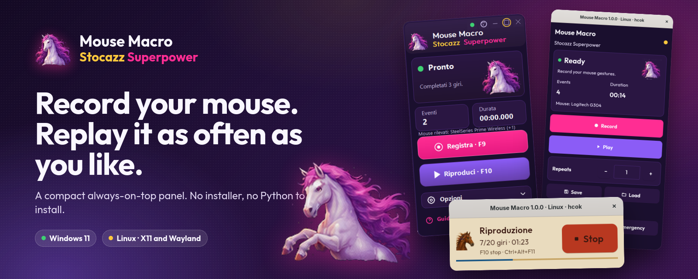
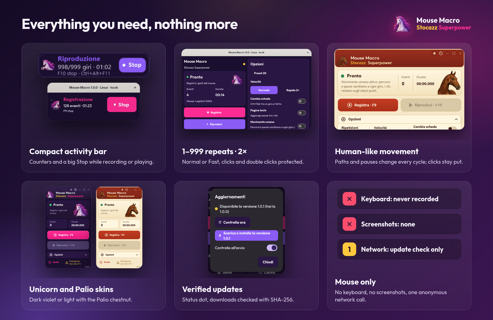
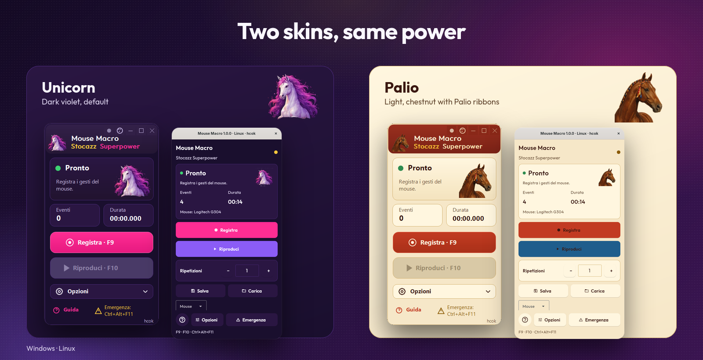
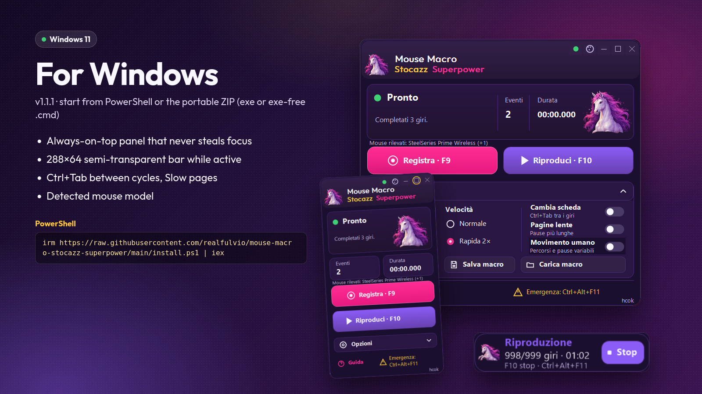
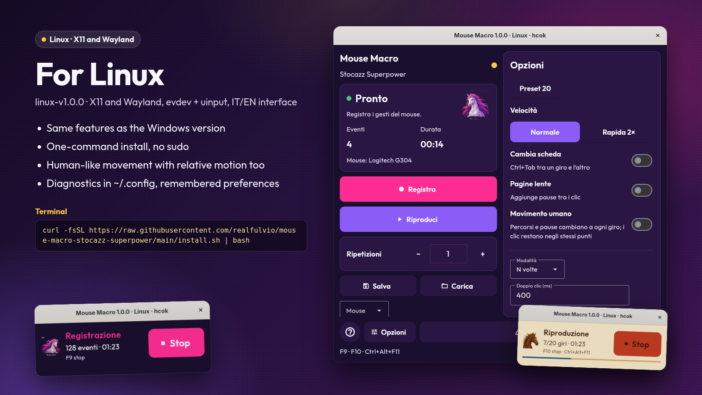
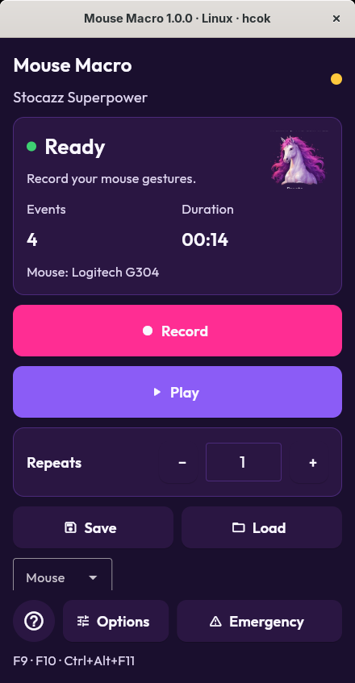
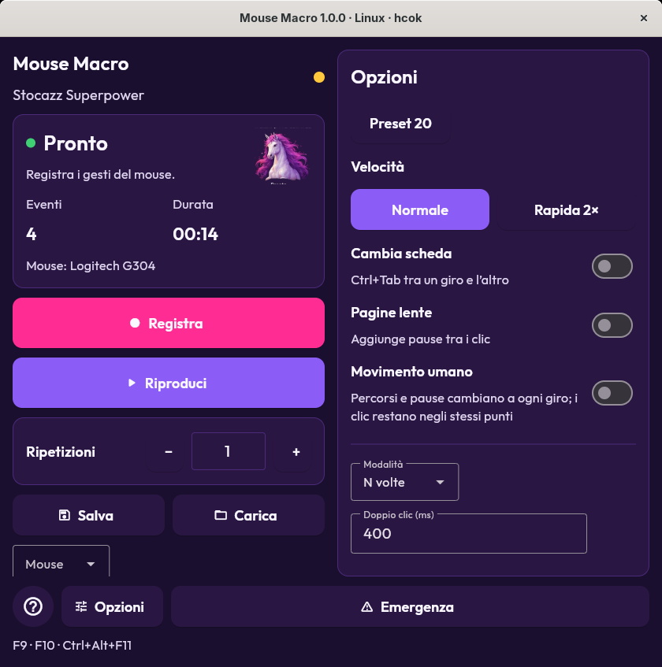
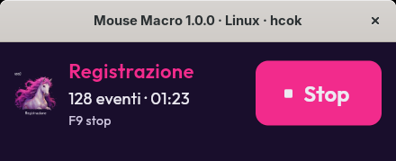
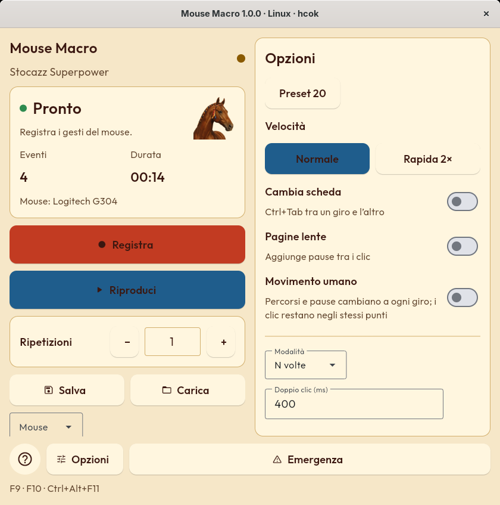

<p align="center"><a href="PRESENTAZIONE.md">Italiano</a> · <b>English</b></p>

<p align="center"></p>

# Mouse Macro Stocazz Superpower

**Record your mouse. Replay it as often as you like.** A small always-on-top panel for Windows and Linux: press F9, do your clicks, press F9 again, then F10 to replay them 1 to 999 times. No complicated installer, no Python to install, free for personal use.

## Who it is for

- Anyone repeating the same click sequence every day in a browser game, a business app or a web form.
- Anyone who wants to go through dozens of browser tabs doing the same thing in each one (Ctrl+Tab between cycles).
- Anyone looking for a small, readable tool without endless menus and without keyboard recording.

## What it does

<p align="center"></p>

- **Compact always-on-top panel**: big Record/Play buttons, repeats always visible.
- **Compact activity bar**: while recording and replaying the panel becomes a semi-transparent bar with counters and a big **Stop**.
- **1 to 999 repeats**, at **Normal** or **Fast 2×** speed; presses and double clicks stay protected at Fast.
- **Ctrl+Tab between cycles** (optional) to move to the next browser tab; never after the last cycle.
- **Slow pages**: more careful pauses for sites that load slowly.
- **Human-like movement** (optional): every cycle the cursor follows a slightly different path and the pauses vary, yet clicks always land on the same spots.
- **Unicorn and Palio skins**: dark violet, or light with the chestnut wearing Palio ribbons.
- **Verified updates**: a green/yellow dot tells you whether a new version is out; download and install with SHA-256 verification, only when you ask.
- **Mouse model** detected and shown in the panel.
- **Mouse only**: no keyboard recording, no screenshots. The only network request is the anonymous update check, which can be turned off.

<p align="center"></p>

## Windows

<p align="center"></p>

Version **v1.1.1** for Windows 10/11 x64. The easiest way: open PowerShell and paste

```powershell
irm https://raw.githubusercontent.com/realfulvio/mouse-macro-stocazz-superpower/main/install.ps1 | iex
```

The script downloads the official release, verifies its SHA-256 and starts the program with the official signed Python. Alternatively download the **portable ZIP** from the [v1.1.1 release](https://github.com/realfulvio/mouse-macro-stocazz-superpower/releases/tag/v1.1.1), extract it and open `Mouse Macro v1.1.1.exe`, or `Mouse Macro v1.1.1 (senza exe).cmd` if Windows blocks the exe.

## Linux

<p align="center"></p>

Version **linux-v1.0.0** for Linux x86_64, X11 and Wayland, with the features of the Windows version and an Italian or English interface. One-command install, no sudo:

```bash
curl -fsSL https://raw.githubusercontent.com/realfulvio/mouse-macro-stocazz-superpower/main/install.sh | bash -s -- --en
```

The script finds the newest Linux release, verifies its SHA-256, installs to `~/.local/share`, adds a launcher to the applications menu and starts the panel. Alternatively download the `tar.gz` package from the [linux-v1.0.0 release](https://github.com/realfulvio/mouse-macro-stocazz-superpower/releases/tag/linux-v1.0.0), check the SHA-256 and run `MouseMacroStocazzSuperpower-Linux-EN`. A portable double-click version (AppImage) and a Flatpak are in preparation.

## Good to know, honestly

- **Windows** replays **absolute coordinates**: keep window positions, resolution and display scale unchanged.
- **Linux** stores **relative movements** (on Wayland no program can read the cursor position): bring the cursor back to the starting point before each replay and use the flat mouse acceleration profile for best accuracy.
- On Linux a one-time `uaccess` udev rule is needed to read the mouse and keys (`setup-linux-input.sh`, asks for your sudo password).
- The program cannot tell whether a site accepted a click, and human-like movement **does not make automation undetectable**: many sites forbid it in their terms.
- [PolyForm Noncommercial 1.0.0](../../LICENSE) license: free for personal and non-commercial use, no commercial resale.

## Screenshots

| Windows | Linux |
|---|---|
|  |  |
|  |  |
|  |  |
|  |  |

## Images for social media

| File | Use |
|---|---|
| [`images/hero-en.png`](images/hero-en.png) · [`hero-it.png`](images/hero-it.png) | 1600×640 banner for pages, blogs, forums |
| [`images/social-en.png`](images/social-en.png) · [`social-it.png`](images/social-it.png) | 1200×630 link preview (Open Graph, X, Facebook, Telegram) |
| [`images/features-en.png`](images/features-en.png) · [`features-it.png`](images/features-it.png) | The six main features |
| [`images/windows-en.png`](images/windows-en.png) · [`linux-en.png`](images/linux-en.png) | One card per platform (also `-it`) |
| [`images/skins-en.png`](images/skins-en.png) · [`skins-it.png`](images/skins-it.png) | The two skins side by side |

All images use real screenshots of the program and can be regenerated with [`make_images.py`](make_images.py).

**Short text to share:** *Mouse Macro Stocazz Superpower: record your mouse and replay the sequence 1 to 999 times. Compact panel for Windows and Linux, Fast 2×, Ctrl+Tab between tabs, human-like movement, Unicorn and Palio skins. Free for personal use: https://github.com/realfulvio/mouse-macro-stocazz-superpower*

Project and design: **hcok**.
