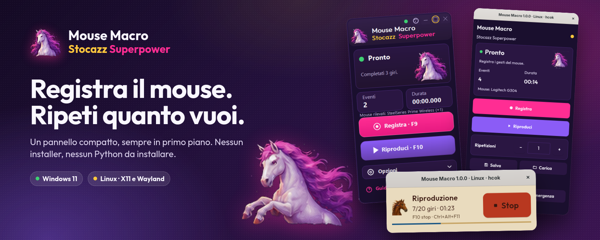
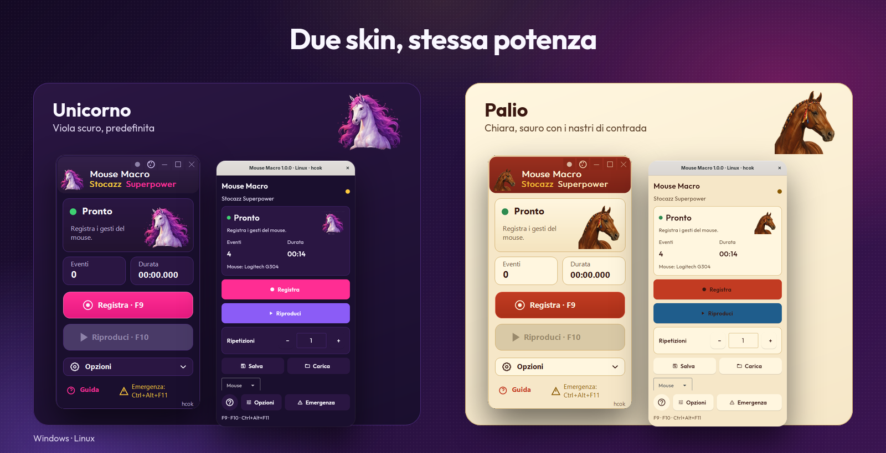
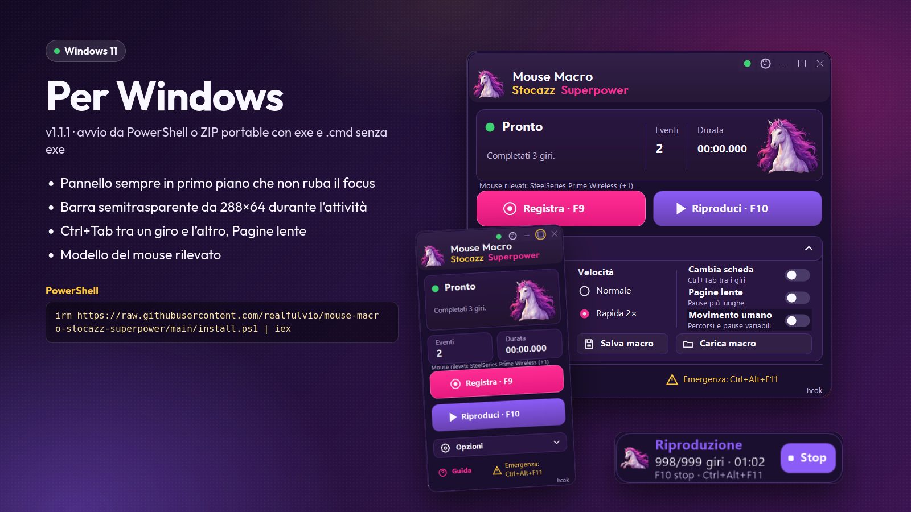
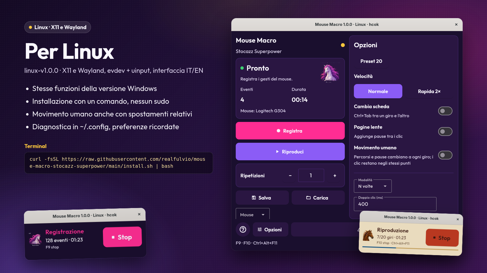

<p align="center"><b>Italiano</b> · <a href="PRESENTATION.en.md">English</a></p>

<p align="center"></p>

# Mouse Macro Stocazz Superpower

**Registra il mouse. Ripeti quanto vuoi.** Un piccolo pannello sempre in primo piano per Windows e Linux: premi F9, fai i tuoi clic, premi di nuovo F9, poi F10 per ripeterli da 1 a 999 volte. Niente installer complicati, niente Python da installare, gratis per uso personale.

## Per chi è

- Chi ripete ogni giorno la stessa sequenza di clic in un gioco browser, in un gestionale o in un modulo web.
- Chi vuole scorrere decine di schede del browser facendo la stessa cosa in ognuna (Ctrl+Tab tra un giro e l'altro).
- Chi cerca uno strumento piccolo e leggibile, senza menu infiniti e senza registrare la tastiera.

## Cosa sa fare

<p align="center"></p>

- **Pannello compatto sempre in primo piano**: pulsanti grandi Registra/Riproduci, ripetizioni sempre visibili.
- **Barra attiva compatta**: durante registrazione e replay il pannello diventa una barra semitrasparente con contatori e uno **Stop** grande.
- **Da 1 a 999 ripetizioni**, a velocità **Normale** o **Rapida 2×**; pressioni e doppi clic restano protetti anche in Rapida.
- **Ctrl+Tab tra i giri** (facoltativo) per passare alla scheda successiva del browser; mai dopo l'ultimo giro.
- **Pagine lente**: pause più prudenti per i siti che caricano piano.
- **Movimento umano** (facoltativo): a ogni giro il cursore segue un percorso leggermente diverso e le pause variano, ma i clic cadono sempre negli stessi punti.
- **Skin Unicorno e Palio**: viola scuro o chiara con il sauro dai nastri di contrada.
- **Aggiornamenti verificati**: un pallino verde/giallo indica se c'è una versione nuova; download e installazione con controllo SHA-256, solo se lo chiedi tu.
- **Modello del mouse** riconosciuto e mostrato nel pannello.
- **Solo il mouse**: non registra la tastiera, non fa screenshot. L'unica richiesta di rete è il controllo anonimo degli aggiornamenti, disattivabile.

<p align="center"></p>

## Windows

<p align="center"></p>

Versione **v1.1.1** per Windows 10/11 x64. Il modo più semplice: apri PowerShell e incolla

```powershell
irm https://raw.githubusercontent.com/realfulvio/mouse-macro-stocazz-superpower/main/install.ps1 | iex
```

Lo script scarica la release ufficiale, ne verifica lo SHA-256 e avvia il programma con il Python ufficiale firmato. In alternativa scarica lo **ZIP portable** dalla [release v1.1.1](https://github.com/realfulvio/mouse-macro-stocazz-superpower/releases/tag/v1.1.1), estrailo e apri `Mouse Macro v1.1.1.exe` oppure, se Windows blocca l'exe, `Mouse Macro v1.1.1 (senza exe).cmd`.

## Linux

<p align="center"></p>

Versione **linux-v1.0.0** per Linux x86_64, X11 e Wayland, con le stesse funzioni della versione Windows e interfaccia in italiano o inglese. Installazione con un comando, senza sudo:

```bash
curl -fsSL https://raw.githubusercontent.com/realfulvio/mouse-macro-stocazz-superpower/main/install.sh | bash
```

Lo script trova l'ultima release Linux, verifica lo SHA-256, installa in `~/.local/share`, aggiunge l'icona nel menu e avvia il pannello. In alternativa scarica il pacchetto `tar.gz` dalla [release linux-v1.0.0](https://github.com/realfulvio/mouse-macro-stocazz-superpower/releases/tag/linux-v1.0.0), controlla gli SHA-256 ed esegui `MouseMacroStocazzSuperpower-Linux-IT`. Una versione portable a doppio clic (AppImage) e una versione Flatpak sono in preparazione.

## Da sapere, con onestà

- **Windows** riproduce a **coordinate assolute**: tieni uguali posizione delle finestre, risoluzione e scala dello schermo.
- **Linux** registra **spostamenti relativi** (su Wayland nessun programma può leggere la posizione del cursore): riporta il cursore al punto di partenza prima di ogni replay e usa il profilo di accelerazione del mouse piatto per la massima precisione.
- Su Linux serve, una volta sola, la regola udev `uaccess` per leggere mouse e tasti (`setup-linux-input.sh`, chiede la password di sudo).
- Il programma non sa se un sito ha accettato un clic e il Movimento umano **non rende invisibile l'automazione**: molti siti la vietano nei loro termini.
- Licenza [PolyForm Noncommercial 1.0.0](../../LICENSE): uso libero personale e non commerciale, vietata la rivendita.

## Schermate

| Windows | Linux |
|---|---|
|  |  |
|  |  |
|  |  |
|  |  |

## Immagini per i social

| File | Uso |
|---|---|
| [`images/hero-it.png`](images/hero-it.png) · [`hero-en.png`](images/hero-en.png) | Banner 1600×640 per pagina, blog, forum |
| [`images/social-it.png`](images/social-it.png) · [`social-en.png`](images/social-en.png) | Anteprima 1200×630 per link condivisi (Open Graph, X, Facebook, Telegram) |
| [`images/features-it.png`](images/features-it.png) · [`features-en.png`](images/features-en.png) | Le sei funzioni principali |
| [`images/windows-it.png`](images/windows-it.png) · [`linux-it.png`](images/linux-it.png) | Schede dedicate a ciascun sistema (anche `-en`) |
| [`images/skins-it.png`](images/skins-it.png) · [`skins-en.png`](images/skins-en.png) | Le due skin a confronto |

Le immagini usano schermate reali del programma. Si rigenerano con [`make_images.py`](make_images.py).

**Testo breve da condividere:** *Mouse Macro Stocazz Superpower: registra il mouse e ripeti la sequenza da 1 a 999 volte. Pannello compatto per Windows e Linux, Rapida 2×, Ctrl+Tab tra le schede, movimento umano, skin Unicorno e Palio. Gratis per uso personale: https://github.com/realfulvio/mouse-macro-stocazz-superpower*

Progetto e design: **hcok**.
